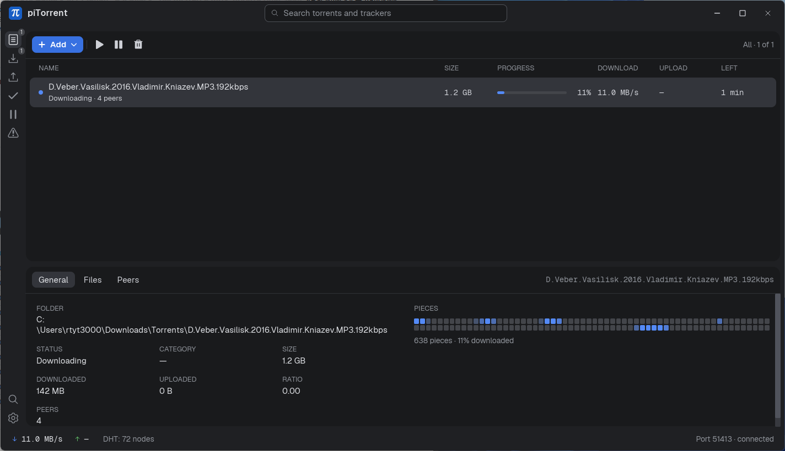

# piTorrent

[](https://github.com/rtyt3000/piTorrent/actions/workflows/release.yml)   



Лёгкий настольный BitTorrent-клиент на Rust с поиском по трекерам через JavaScript-плагины.

Интерфейс — [iced](https://iced.rs), торрент-движок — [librqbit](https://github.com/ikatson/rqbit). Основная платформа — Windows (ассоциации файлов и автозапуск реализованы через реестр), но код собирается и под другие ОС.

## Возможности

- Загрузка и раздача: `.torrent`-файлы и magnet-ссылки, предпросмотр списка файлов перед добавлением, выбор отдельных файлов.
- Очередь загрузок с лимитами на число одновременных загрузок и раздач, изменение приоритета (в начало / вверх / вниз / в конец).
- Ограничения скорости, порт, DHT.
- Категории с собственными папками загрузки.
- Создание `.torrent` из файла или папки.
- Детали торрента: файлы, пиры (с флагами стран по IP), карта частей.
- Поиск по трекерам через плагины (см. [docs/plugins.md](docs/plugins.md)): Jackett / Prowlarr, Internet Archive, свои плагины.
- Трей, закрытие в трей, автозапуск, уведомления о завершении, один экземпляр приложения.
- Регистрация как обработчика `.torrent` и `magnet:`.
- Тёмная/светлая тема, русский и английский интерфейс.

## Сборка и запуск

Нужен Rust с поддержкой edition 2024.

### Linux

Для сборки нужны компилятор C, `pkg-config` и dev-пакеты GTK 3 и libayatana-appindicator (для трея), например на Fedora:

```sh
sudo dnf install gcc pkgconf-pkg-config gtk3-devel libayatana-appindicator-gtk3-devel libxkbcommon-devel wayland-devel
```

На Debian/Ubuntu: `build-essential pkg-config libgtk-3-dev libayatana-appindicator3-dev libxkbcommon-dev libwayland-dev`.

Готовый архив (`piTorrent-<версия>-linux-x86_64.tar.gz`) лежит в релизах. Ему нужны `libgtk-3` и `libayatana-appindicator3` (в Fedora они обычно уже есть, в Ubuntu: `libgtk-3-0 libayatana-appindicator3-1`).

Что важно знать:

- Трей работает через StatusNotifier/AppIndicator. В GNOME для него нужно расширение AppIndicator; без него значок не виден, поэтому там лучше отключить «Закрывать в трей».
- Пароли плагинов хранятся в Secret Service (gnome-keyring, KWallet, KeePassXC).
- Кнопка ассоциаций создаёт `~/.local/share/applications/piTorrent.desktop` с иконкой и вызывает `xdg-mime` (нужен пакет `xdg-utils`).
- Окно без рамки, скруглённых углов и тени нет.

```sh
cargo run --release
cargo test
```

Переменные окружения:

| Переменная | Назначение |
|---|---|
| `PITORRENT_PROFILE=name` | Отдельная папка данных (`piTorrent-name`) и порт single-instance, чтобы запускать вторую копию параллельно |
| `PITORRENT_DEMO=1` | Фиктивный движок с примерами торрентов — для разработки интерфейса и скриншотов без сети |

## Релизы

Релизы собирает GitHub Actions ([.github/workflows/release.yml](.github/workflows/release.yml)): достаточно запушить тег `vX.Y.Z`, совпадающий с `version` в `Cargo.toml`. Для Windows и Linux собираются архивы (`scripts/package.ps1`, `scripts/package.sh`) с файлами `.sha256`, они прикрепляются к релизу. Проверка сборки и тестов на обеих ОС — `.github/workflows/ci.yml`.

## Данные

Хранятся в `<config dir>/piTorrent/` (на Windows — `%APPDATA%\piTorrent`):

- `settings.json` — настройки приложения;
- `categories.json` — категории и их привязка к торрентам (по info hash);
- `queue.json` — очередь и порядок приоритетов;
- `plugins.json` и `plugins/` — настройки и установленные плагины.

Пароли и cookie плагинов лежат не в файле, а в системном хранилище учётных данных.

## Документация

- [docs/architecture.md](docs/architecture.md) — устройство проекта.
- [docs/plugins.md](docs/plugins.md) — как писать плагины поиска.
- [AGENTS.md](AGENTS.md) — заметки для ИИ-агентов и контрибьюторов.

Код распространяется под лицензией [MIT](LICENSE). Иконки в `assets/icons` распространяются по собственным лицензиям (см. файлы `LICENSE*` в этой папке). Шрифт — Geist.

Страны пиров определяются офлайн по базе [IP to Country Lite](https://db-ip.com) от DB-IP (CC BY 4.0), флаги — [flagcdn.com](https://flagcdn.com). Данные в `assets/geo/` собирает `tools/gen_geo.py`.

